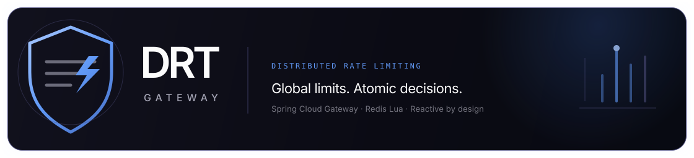
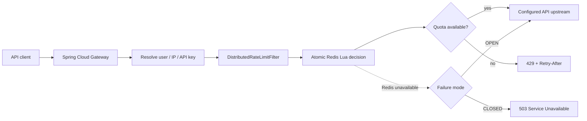

<div align="center">
  
  <br />
  <br />
  <p><strong>One gateway. Three algorithms. Atomic decisions across every instance.</strong></p>
  <p>Protect Spring Cloud Gateway APIs with Redis-backed distributed rate limits and an operator-focused control-plane preview.</p>
  <br />
  
  
  
</div>

<br />

> **DRT** evaluates each request against shared Redis state. Every algorithm performs its check-and-consume operation in one Lua script, preventing gateway instances from racing each other for quota.

## At a glance

| Capability | Implementation |
|---|---|
| **Token bucket** | Configurable burst capacity and sustained refill rate |
| **Sliding-window log** | Exact rolling count with a Redis sorted set |
| **Sliding-window counter** | Weighted previous/current buckets with lower memory overhead |
| **Distributed atomicity** | One Redis Lua execution per identity decision |
| **Clock source** | Redis `TIME`, shared across gateway instances |
| **Identity dimensions** | Authenticated user, socket peer IP, and API key |
| **Redis outage policy** | Explicit fail-open or fail-closed behavior |
| **Gateway response** | `429` with limit, remaining, and retry headers |
| **Control-plane UI** | Responsive React/Vite preview with clearly labeled sample data |

## Architecture



## Quick start

### Prerequisites

- Java 17 or later
- Maven 3.9 or later
- Docker with Compose, or an existing Redis 7-compatible service

### Start Redis and the gateway

```bash
docker compose up -d redis
mvn spring-boot:run
```

The gateway listens on `http://localhost:8080`. The example route proxies `/api/**` to `http://localhost:8081`; point it at your service with `UPSTREAM_URI`.

```bash
REDIS_HOST=redis.internal \
UPSTREAM_URI=https://api.example.com \
RATE_LIMIT_ALGORITHM=SLIDING_WINDOW_LOG \
RATE_LIMIT_FAILURE_MODE=CLOSED \
mvn spring-boot:run
```

### Start the control-plane preview

The dashboard runs independently from the gateway:

```bash
cd frontend
npm ci
npm run dev
```

Open `http://localhost:5173`. Set `GATEWAY_TARGET` if the Spring Gateway is not available at `http://localhost:8080`; Vite proxies `/api` and `/actuator` through to that target.

> **Preview boundary:** Dashboard metrics, request events, and Redis node details are sample data. Policy edits and generated test requests remain in browser state; they do not configure Spring Boot or persist to Redis. The gateway does not yet expose an administrative policy API.

## Rate-limit algorithms

Choose one shared strategy with `RATE_LIMIT_ALGORITHM`:

### `TOKEN_BUCKET`

- `limit` is the bucket capacity and maximum burst.
- `refill-per-second` controls the sustained request rate.
- The Lua script reads Redis time, refills tokens, and consumes one token atomically.

### `SLIDING_WINDOW_LOG`

- `limit` is the maximum count within `window`.
- A sorted set tracks individual request timestamps; unique members prevent same-millisecond requests from overwriting each other.
- This is the most exact rolling-window option, with memory proportional to requests in the active window.

### `SLIDING_WINDOW_COUNTER`

- `limit` is the maximum count within `window`.
- The Lua script weights the previous fixed bucket against the current bucket.
- It uses less memory than the exact log, with expected boundary approximation.

For either sliding-window strategy, `refill-per-second` is unused. Inactive keys expire automatically. All scripts use Redis `TIME`, so gateway host clock skew does not affect decisions. Keep Redis itself synchronized; a large Redis wall-clock correction can affect time-based windows.

## Identity model

The global filter checks enabled dimensions in sequence:

1. **User** — authenticated `Principal.getName()`, falling back to `X-User-Id`.
2. **IP** — the socket peer address (`remoteAddress`). Arbitrary `X-Forwarded-For` values are not trusted.
3. **API key** — the `X-API-Key` request header.

A request must pass every applicable dimension. If a user or API-key identity is absent, that dimension is skipped; the IP policy remains independent. Redis keys contain a SHA-256 digest of each identity rather than the raw value.

**Security note:** Strip and replace user identity headers at trusted authentication middleware. If the gateway is behind a proxy, configure and verify trusted client-IP handling before relying on IP-based limits; do not accept client-supplied forwarding headers as identity.

## Redis failure policy

Set `RATE_LIMIT_FAILURE_MODE` explicitly for your service’s availability and abuse-risk profile:

| Mode | Redis unavailable | Trade-off |
|---|---|---|
| `OPEN` *(default)* | Continue to the upstream | Preserves availability; quotas are temporarily unenforced |
| `CLOSED` | Return `503 Service Unavailable` | Protects downstream capacity; makes Redis availability part of API availability |

A `429 Too Many Requests` is returned only when Redis successfully evaluates the request and its quota is exhausted. Redis errors follow the configured outage mode. Alert on Redis errors and validate failover behavior under load.

## Configuration

Defaults are defined in `src/main/resources/application.yml` and can be overridden through environment variables.

| Variable | Default | Purpose |
|---|---:|---|
| `SERVER_PORT` | `8080` | Gateway listen port |
| `REDIS_HOST` | `localhost` | Redis hostname |
| `REDIS_PORT` | `6379` | Redis port |
| `REDIS_PASSWORD` | empty | Redis password, if required |
| `UPSTREAM_URI` | `http://localhost:8081` | Destination for `/api/**` |
| `RATE_LIMIT_ENABLED` | `true` | Enable the global rate-limit filter |
| `RATE_LIMIT_ALGORITHM` | `TOKEN_BUCKET` | `TOKEN_BUCKET`, `SLIDING_WINDOW_LOG`, or `SLIDING_WINDOW_COUNTER` |
| `RATE_LIMIT_FAILURE_MODE` | `OPEN` | `OPEN` or `CLOSED` when Redis errors |
| `RATE_LIMIT_KEY_PREFIX` | `drt:rl:v1` | Namespace for limiter keys |
| `RATE_LIMIT_USER_LIMIT` | `100` | User capacity / sliding-window maximum |
| `RATE_LIMIT_USER_REFILL_PER_SECOND` | `10` | User token-bucket refill rate |
| `RATE_LIMIT_USER_WINDOW` | `1m` | User sliding-window duration |
| `RATE_LIMIT_IP_LIMIT` | `300` | IP capacity / sliding-window maximum |
| `RATE_LIMIT_IP_REFILL_PER_SECOND` | `30` | IP token-bucket refill rate |
| `RATE_LIMIT_IP_WINDOW` | `1m` | IP sliding-window duration |
| `RATE_LIMIT_API_KEY_LIMIT` | `1000` | API-key capacity / sliding-window maximum |
| `RATE_LIMIT_API_KEY_REFILL_PER_SECOND` | `100` | API-key token-bucket refill rate |
| `RATE_LIMIT_API_KEY_WINDOW` | `1m` | API-key sliding-window duration |
| `GATEWAY_TARGET` | `http://localhost:8080` | Gateway target for the frontend dev proxy |

### Example policy configuration

```yaml
drt:
  rate-limit:
    enabled: true
    algorithm: TOKEN_BUCKET
    failure-mode: CLOSED
    user:
      enabled: true
      limit: 100
      refill-per-second: 10
      window: 1m
    ip:
      enabled: true
      limit: 300
      refill-per-second: 30
      window: 1m
    api-key:
      enabled: true
      limit: 1000
      refill-per-second: 100
      window: 1m
```

For sliding windows, `limit` and `window` define the policy; refill rates only apply to token buckets.

## Responses and observability

- Exceeded quota: HTTP `429` with `RateLimit-Limit`, `RateLimit-Remaining`, and `Retry-After` headers.
- Redis unavailable with `CLOSED`: HTTP `503 Service Unavailable`.
- Redis unavailable with `OPEN`: request continues to the configured upstream.
- Spring Boot Actuator health endpoint: `/actuator/health`.

## Development checks

```bash
# Frontend tests and production bundle
cd frontend
npm ci
npm test
npm run build

# Spring Boot application
cd ..
mvn test
```

## Repository layout

```text
.
├── docs/assets/drt-logo.svg          # DRT project lockup
├── frontend/                         # React/Vite control-plane preview
├── src/main/java/dev/drt/gateway/    # Spring Boot gateway and filter
├── src/main/resources/redis/         # Atomic Lua limiter scripts
├── src/main/resources/application.yml
├── docker-compose.yml                # Local Redis service
└── pom.xml
```

## Operational considerations

- Use a highly available Redis deployment for production and measure its latency under peak load.
- All nodes in a deployment should use the same limiter algorithm and policy configuration.
- Redis is the shared source of truth; adding local per-instance counters would weaken global enforcement.
- Redis Cluster script keys use a shared hash tag so related state stays in one slot.
- Consider the trade-off between fail-open and fail-closed separately for each protected API and downstream dependency.
